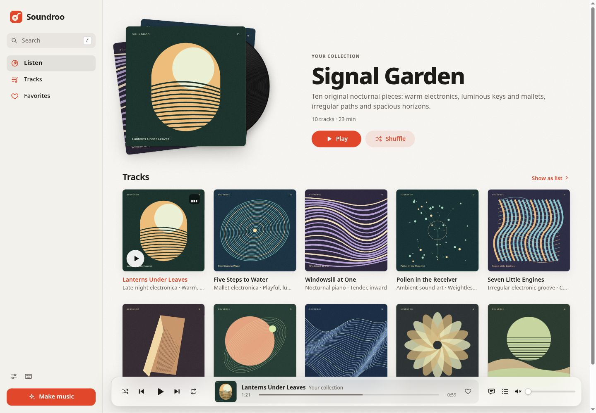

<p align="center">
  <a href="https://soundroo.com">
    
  </a>
</p>

<h1 align="center">Soundroo</h1>

<p align="center">
  <b>Music made by your AI agent.</b><br>
  Free and open source. Composing, rendering and playback run on your computer.
</p>

<p align="center">
  <a href="https://soundroo.com">Website</a> &nbsp;·&nbsp;
  <a href="https://soundroo.com/docs">Docs</a> &nbsp;·&nbsp;
  <a href="https://soundroo.com/make/custom">Prompt builder</a> &nbsp;·&nbsp;
  <a href="AGENTS.md">AGENTS.md</a>
</p>



**Listen first:** the [Turn It Up](https://soundroo.com/@soundroo/collections/turn-it-up)
collection was written with this toolkit, from the
[rock and roll boogie](https://soundroo.com/@soundroo/hotwire-boogie) to the
[nu-disco funk](https://soundroo.com/@soundroo/mirrorball-shift) and
[hyperpop](https://soundroo.com/@soundroo/pixel-riot).

## Make a track

> [!TIP]
> **Give your AI agent this repo and say what you'd like to hear.**
> It works with Claude Code, Codex and other coding agents that can run
> commands. ChatGPT and Claude use the Soundroo connector instead.

Copy this into your agent and put your idea where the brackets are:

```text
Make me a track: [what it should sound like, or "surprise me"].
Use Soundroo for it. If you have Soundroo tools, use them. If you can run commands, clone https://github.com/vincentsch/soundroo, read its AGENTS.md and follow the steps. If you can't do either, send me to https://soundroo.com/connect
```

A few words are enough, like "a fast funk track for a summer road trip" or
"something that sounds like an 80s arcade game". The agent sets up Soundroo,
writes the track and opens a small music player in your browser. You listen,
tell it what to change, and ask for more when you like it.

Unless you ask for something calm, the music is lively: drums and bass from
the first bars, a hook early on and a chorus or a drop.

## How does it work?

The agent writes the music as a score, a small JSON file with the tempo,
the instruments and the notes. Drum patterns look like `X...x...X...x...`, and
melodies like `G4/.5 Bb4 C5/1`. Soundroo's engine reads the score, plays each
note, then mixes and masters the parts into a stereo track.

The engine has 32 instrument types. Grand piano, string and brass sections,
clean and overdriven electric guitars, electric bass and an acoustic drum kit
play recordings of real instruments (all public domain; see
[assets/samples/SOURCES.md](assets/samples/SOURCES.md)). Electric piano, organ,
analog and FM synthesizers, pads, synth basses, bells, marimba, a drum machine
and 8-bit chip sounds for video game music are synthesized. Short spoken phrases can become rhythmic chops, tape and grain
textures or a vocoder robot voice. The words come from
[Kokoro](https://huggingface.co/hexgrad/Kokoro-82M), a small voice model that
runs on your computer. It speaks, it doesn't sing.

An agent can't hear music, so Soundroo checks each render for clipping,
silence, squashed levels and big jumps in loudness. It can't tell whether the
music is good. Because the track is a score, the agent can change one part and
keep the others. "Keep the melody, make the drums softer" works.

None of this needs an account, an API key, music software or a graphics card,
and none of it leaves your computer. Your AI agent is a separate service with
its own terms and prices.

## The music player

The player has generated cover art, collections, a queue, favorites and a
full-screen view that moves with the music. Open a track to see its sections,
leave notes at a moment in the track or compare versions. The mixer changes
levels, panning, mute and solo and saves the mix as a new version. Keyboard
controls and light and dark themes are built in.

You can download each track as WAV, the editable score, MIDI for other music
programs, separate instrument tracks (stems) and a small listening page that
works offline.

## Share it on soundroo.com

When your music is ready, the agent asks whether to put it on
[soundroo.com](https://soundroo.com). If you say yes, it sends the score, and
soundroo.com renders the audio with the same engine. You get links that play
in any browser, to send to friends.

The first share needs no account. Soundroo makes an artist page for you with a
made-up name, and its music is unlisted. That page holds up to 10 tracks. To
keep it and list your music publicly, give the agent your email address. It
runs `node bin/soundroo.js claim --email you@example.com`, and you open the
email and press the button. [Sharing](docs/sharing.md) explains what is sent
and every option.

## ChatGPT and Claude

Chat apps can't run this toolkit, so soundroo.com has a connector for them, a
remote MCP server. Add it once and sign in, then paste the same prompt into a
chat. You get a link to a private preview of your track.
[soundroo.com/connect](https://soundroo.com/connect) shows the steps.

## Install it yourself

You need [Node.js](https://nodejs.org) 22 or newer. I develop Soundroo on
Linux, and its tests run on Linux, macOS and Windows.

```bash
git clone https://github.com/vincentsch/soundroo.git
cd soundroo
node bin/soundroo.js start
```

Open the address it prints, usually `http://127.0.0.1:4317`. The first start
renders **Turn It Up**, ten example tracks from rock and roll to dance-pop,
UK garage and hyperpop. Then start your agent in the `soundroo` folder and ask
for a track. It follows [AGENTS.md](AGENTS.md).

Useful commands:

```bash
node bin/soundroo.js --help
node bin/soundroo.js doctor
node bin/soundroo.js catalog
node bin/soundroo.js init library/my-music --title "After Hours"
node bin/soundroo.js validate my-track.json --json
node bin/soundroo.js add my-track.json --library library/my-music
node bin/soundroo.js render --all --library library/my-music
node bin/soundroo.js start library/my-music
```

For spoken words, install the optional voice model once:

```bash
npm install --no-save --package-lock=false kokoro-js@1.2.1 @huggingface/transformers@3.8.1
node bin/soundroo.js voice create "We are made of light" --out library/assets/phrase.wav
```

The first spoken render downloads the model once. Instrumental music never needs it.

## Write music yourself

[The composing guide](docs/composing.md) has the score format and a complete
example track. [Musical directions](docs/musical-directions.md) and
[Grooves](docs/grooves.md) cover hooks, sections and drum and bass patterns
for many styles. [The headless engine](docs/headless.md) validates and renders
scores for servers and other tools.

## Credits and license

Soundroo is MIT licensed. Copyright (c) 2026 Vincent Schmalbach. Spoken words
come from [Kokoro](https://huggingface.co/hexgrad/Kokoro-82M) through
[kokoro-js](https://github.com/hexgrad/kokoro) and
[Transformers.js](https://github.com/huggingface/transformers.js), both
optional. The sharing helper is built with
[rungrad](https://github.com/vincentsch/rungrad). Licenses of the optional
parts are in [Third party notices](THIRD_PARTY_NOTICES.md).
